# 学生读书笔记共享

> 🎓 **计算机毕业设计 · 学生读书笔记共享**
>
> 本仓库只放**项目介绍 + 运行截图**（截图是站点带水印的原图，存在仓库 `images/` 里）。
>
> 👉 **完整可运行源码 / 数据库脚本 / 部署文档：[点我获取](https://geekcode.top/archives/%E5%AD%A6%E7%94%9F%E8%AF%BB%E4%B9%A6%E7%AC%94%E8%AE%B0%E5%85%B1%E4%BA%AB?utm_source=github)**
>
> 💬 咨询微信：**ir9372**　|　🌐 更多项目：[极客代码 geekcode.top](https://geekcode.top/?utm_source=github)
>
> 📌 项目详情页：<https://geekcode.top/archives/%E5%AD%A6%E7%94%9F%E8%AF%BB%E4%B9%A6%E7%AC%94%E8%AE%B0%E5%85%B1%E4%BA%AB?utm_source=github>

<table><td width="230" align="center"> <b>扫码加微信 ir9372</b></td><td valign="middle">📦 源码 = 项目介绍 + 全部运行截图 + 数据库 + 部署文档 👉 点上方任意截图，直接跳到 <b>极客代码 geekcode.top</b> 详情页</td></table>

---

<h1>学生读书笔记共享</h1>
<h2>项目概述</h2>

学生读书笔记共享面向学生阅读学习与笔记交流场景，围绕笔记分享、交流互动、公告信息和个人笔记等模块，提供笔记浏览、评论信息查看、公告查看、个人中心、我的发布、我的收藏等功能。系统采用 Vue 与 Spring Boot 整合的前后端架构，后端使用 Spring Boot、MyBatis-Plus、Shiro 和 MySQL，实现业务数据持久化、访问控制和前后端交互。适用于学生、管理员等用户，管理员可维护笔记分享、评论、交流互动、公告、个人笔记、收藏、用户和轮播图配置等后台业务数据。

<h2>技术架构</h2>
<h3>总体架构</h3>

本项目为 <code>vue-integrated</code> 类型，前端页面与后端接口整合在同一个项目体系中，前台用户端和后台管理端均通过浏览器访问，后端基于 Spring Boot 提供 Web 接口，并依托 MyBatis-Plus 完成数据访问，使用 Shiro 实现身份认证与访问控制。

<a href="https://geekcode.top/archives/%E5%AD%A6%E7%94%9F%E8%AF%BB%E4%B9%A6%E7%AC%94%E8%AE%B0%E5%85%B1%E4%BA%AB?utm_source=github" title="查看完整源码">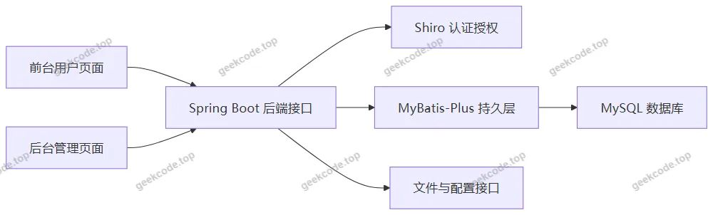</a>

<h3>后端技术选型</h3>
<table>
<thead>
<tr>
<th>技术</th>
<th>作用</th>
</tr>
</thead>
<tbody><tr>
<td>Spring Boot</td>
<td>提供 Web 接口、应用启动和后端业务组织能力</td>
</tr>
<tr>
<td>Spring Boot Starter Web</td>
<td>支撑 HTTP 接口与页面访问</td>
</tr>
<tr>
<td>MyBatis-Plus</td>
<td>简化数据库访问和实体映射，支撑业务数据持久化</td>
</tr>
<tr>
<td>MyBatis Spring Boot Starter</td>
<td>整合 MyBatis 与 Spring Boot</td>
</tr>
<tr>
<td>Spring Boot Starter JDBC</td>
<td>提供 JDBC 数据访问基础能力</td>
</tr>
<tr>
<td>MySQL Connector Java</td>
<td>连接 MySQL 数据库</td>
</tr>
<tr>
<td>Shiro</td>
<td>实现登录认证、访问控制和后台资源保护</td>
</tr>
<tr>
<td>Validation API</td>
<td>用于接口参数校验</td>
</tr>
<tr>
<td>Commons Lang3</td>
<td>提供通用工具类支持</td>
</tr>
<tr>
<td>Protobuf Java</td>
<td>作为项目依赖之一参与数据序列化或相关支持</td>
</tr>
</tbody></table>
<h3>后端接口模块</h3>

项目 Controller 与业务模块对应关系如下：

<table>
<thead>
<tr>
<th>Controller</th>
<th>对应业务模块</th>
</tr>
</thead>
<tbody><tr>
<td>BijifenxiangController</td>
<td>笔记分享</td>
</tr>
<tr>
<td>DiscussbijifenxiangController</td>
<td>笔记分享评论</td>
</tr>
<tr>
<td>GerenbijiController</td>
<td>个人笔记</td>
</tr>
<tr>
<td>ForumController</td>
<td>交流互动</td>
</tr>
<tr>
<td>NewsController</td>
<td>公告信息</td>
</tr>
<tr>
<td>StoreupController</td>
<td>我的收藏</td>
</tr>
<tr>
<td>YonghuController</td>
<td>用户管理</td>
</tr>
<tr>
<td>UserController</td>
<td>后台用户管理</td>
</tr>
<tr>
<td>ConfigController</td>
<td>系统配置管理</td>
</tr>
<tr>
<td>FileController</td>
<td>文件相关接口</td>
</tr>
<tr>
<td>CommonController</td>
<td>公共接口</td>
</tr>
</tbody></table>
<h3>数据库设计要点</h3>

数据库围绕学生读书笔记共享业务组织实体关系，主要包含用户、笔记分享、笔记分享评论、个人笔记、交流互动、公告信息、收藏、配置和后台用户等数据对象。

<a href="https://geekcode.top/archives/%E5%AD%A6%E7%94%9F%E8%AF%BB%E4%B9%A6%E7%AC%94%E8%AE%B0%E5%85%B1%E4%BA%AB?utm_source=github" title="查看完整源码">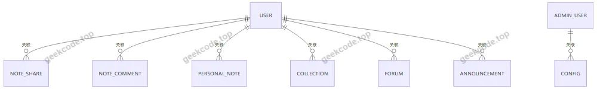</a>

<table>
<thead>
<tr>
<th>数据对象</th>
<th>业务含义</th>
</tr>
</thead>
<tbody><tr>
<td>用户</td>
<td>前台用户信息，与个人笔记、收藏、发布内容等业务相关</td>
</tr>
<tr>
<td>笔记分享</td>
<td>笔记分享业务数据，对应前台笔记分享列表和详情</td>
</tr>
<tr>
<td>笔记分享评论</td>
<td>围绕笔记分享产生的评论数据</td>
</tr>
<tr>
<td>个人笔记</td>
<td>用户个人笔记数据</td>
</tr>
<tr>
<td>交流互动</td>
<td>前台交流互动内容</td>
</tr>
<tr>
<td>公告信息</td>
<td>前台公告信息内容</td>
</tr>
<tr>
<td>收藏</td>
<td>用户收藏数据</td>
</tr>
<tr>
<td>配置</td>
<td>系统配置数据，用于轮播图等配置管理</td>
</tr>
<tr>
<td>后台用户</td>
<td>后台管理员账户数据</td>
</tr>
</tbody></table>
<h3>后台路由与模块对应</h3>
<table>
<thead>
<tr>
<th>后台路由</th>
<th>功能模块</th>
</tr>
</thead>
<tbody><tr>
<td>/forum</td>
<td>交流互动管理</td>
</tr>
<tr>
<td>/news</td>
<td>公告信息管理</td>
</tr>
<tr>
<td>/yonghu</td>
<td>用户管理</td>
</tr>
<tr>
<td>/bijifenxiang</td>
<td>笔记分享管理</td>
</tr>
<tr>
<td>/discussbijifenxiang</td>
<td>笔记分享评论管理</td>
</tr>
<tr>
<td>/gerenbiji</td>
<td>个人笔记管理</td>
</tr>
<tr>
<td>/storeup</td>
<td>我的收藏管理</td>
</tr>
<tr>
<td>/config</td>
<td>配置管理</td>
</tr>
<tr>
<td>/users</td>
<td>后台用户管理</td>
</tr>
</tbody></table>
<h2>功能模块</h2>
<h3>前台用户端</h3>
<table>
<thead>
<tr>
<th>模块</th>
<th>功能描述</th>
</tr>
</thead>
<tbody><tr>
<td>前台首页</td>
<td>作为前台入口页面，展示系统主要功能区域和业务入口</td>
</tr>
<tr>
<td>前台登录页</td>
<td>提供前台用户登录入口</td>
</tr>
<tr>
<td>前台注册页</td>
<td>提供前台用户注册入口</td>
</tr>
<tr>
<td>笔记分享</td>
<td>展示笔记分享列表，可查看笔记分享详情</td>
</tr>
<tr>
<td>笔记分享评论</td>
<td>展示笔记分享评论列表和评论详情</td>
</tr>
<tr>
<td>交流互动</td>
<td>展示交流互动列表，可查看交流互动详情</td>
</tr>
<tr>
<td>公告信息</td>
<td>展示公告信息列表，可查看公告信息详情</td>
</tr>
<tr>
<td>个人笔记</td>
<td>展示个人笔记列表，可查看个人笔记详情</td>
</tr>
<tr>
<td>个人中心</td>
<td>提供个人中心入口，用于查看用户相关信息</td>
</tr>
<tr>
<td>我的发布</td>
<td>提供用户发布内容入口</td>
</tr>
<tr>
<td>我的收藏</td>
<td>展示用户收藏内容列表</td>
</tr>
</tbody></table>

前台导航菜单包括：笔记分享、交流互动、公告信息。 个人中心菜单包括：个人中心、我的发布、我的收藏。

<h3>后台管理端</h3>
<table>
<thead>
<tr>
<th>模块</th>
<th>功能描述</th>
</tr>
</thead>
<tbody><tr>
<td>后台登录页</td>
<td>提供管理员登录入口</td>
</tr>
<tr>
<td>后台首页</td>
<td>作为后台管理入口，展示后台主要管理模块</td>
</tr>
<tr>
<td>轮播图管理</td>
<td>管理前台展示所需的轮播图配置</td>
</tr>
<tr>
<td>笔记分享管理</td>
<td>管理笔记分享业务数据</td>
</tr>
<tr>
<td>笔记分享评论管理</td>
<td>管理笔记分享评论数据</td>
</tr>
<tr>
<td>交流互动管理</td>
<td>管理交流互动数据</td>
</tr>
<tr>
<td>公告信息管理</td>
<td>管理公告信息数据</td>
</tr>
<tr>
<td>个人笔记管理</td>
<td>管理个人笔记数据</td>
</tr>
<tr>
<td>我的收藏管理</td>
<td>管理用户收藏数据</td>
</tr>
<tr>
<td>用户管理</td>
<td>管理前台用户数据</td>
</tr>
<tr>
<td>后台用户管理</td>
<td>管理后台用户账户数据</td>
</tr>
<tr>
<td>配置管理</td>
<td>管理系统配置数据</td>
</tr>
</tbody></table>
<h2>用户角色与权限</h2>
<table>
<thead>
<tr>
<th>角色</th>
<th>可访问模块</th>
<th>权限说明</th>
</tr>
</thead>
<tbody><tr>
<td>前台用户</td>
<td>前台首页、登录页、注册页、笔记分享列表、笔记分享详情、笔记分享评论列表、笔记分享评论详情、交流互动列表、交流互动详情、公告信息列表、公告信息详情、个人笔记列表、个人笔记详情、个人中心、我的发布、我的收藏</td>
<td>可访问前台业务页面，查看笔记分享、公告、交流互动和个人笔记等信息，并通过个人中心查看我的发布和我的收藏</td>
</tr>
<tr>
<td>后台管理员</td>
<td>后台登录页、后台首页、轮播图管理、笔记分享、笔记分享评论、交流互动、公告信息、个人笔记、我的收藏、用户、后台用户、配置</td>
<td>可登录后台并访问对应管理模块，维护笔记分享、评论、交流互动、公告、个人笔记、收藏、用户、后台用户和系统配置等数据</td>
</tr>
</tbody></table>

系统通过 Shiro 实现登录认证和访问控制，前台页面与后台管理模块均纳入统一权限体系。

<h2>项目特色与创新点</h2>
<ul>
<li>聚焦学生读书笔记共享场景，将笔记分享、个人笔记、评论信息、交流互动和公告信息整合到同一系统中。</li>
<li>前台采用清晰的信息组织方式，通过笔记分享、交流互动、公告信息三个导航入口承载主要阅读交流内容。</li>
<li>个人中心提供个人中心、我的发布、我的收藏入口，便于用户管理自身相关业务数据。</li>
<li>后台覆盖笔记分享、笔记分享评论、交流互动、公告信息、个人笔记、我的收藏、用户、后台用户和配置等模块，形成完整的业务管理闭环。</li>
<li>使用 Spring Boot 与 MyBatis-Plus 构建后端业务系统，降低持久层开发复杂度，提高业务模块开发效率。</li>
<li>使用 Shiro 实现身份认证和访问控制，保障前台用户数据与后台管理资源的安全访问。</li>
<li>采用 Vue 与 Spring Boot 整合的项目形态，使前台展示页面、后台管理页面和后端接口能够统一组织。</li>
</ul>
<h2>部署环境</h2>
<table>
<thead>
<tr>
<th>环境项</th>
<th>用途</th>
</tr>
</thead>
<tbody><tr>
<td>JDK</td>
<td>提供 Java 后端运行环境</td>
</tr>
<tr>
<td>MySQL</td>
<td>提供业务数据存储</td>
</tr>
<tr>
<td>Node.js</td>
<td>提供 Vue 前端资源构建环境</td>
</tr>
<tr>
<td>浏览器</td>
<td>访问前台页面和后台管理页面</td>
</tr>
<tr>
<td>Spring Boot 运行环境</td>
<td>承载后端接口、静态资源和业务服务</td>
</tr>
</tbody></table>
<h2>五、技术特性</h2>
<ul>
<li>前后端集成部署，前端资源打包至后端 static 目录</li>
<li>使用 MyBatis-Plus 简化数据访问层开发</li>
<li>集成 Shiro 权限框架实现角色权限控制</li>
</ul>
<h2>六、功能模块截图</h2>
<h3>前台用户端</h3>
<h4>前台首页</h4>

<h4>前台登录页</h4>

<h4>前台注册页</h4>

<a href="https://geekcode.top/archives/%E5%AD%A6%E7%94%9F%E8%AF%BB%E4%B9%A6%E7%AC%94%E8%AE%B0%E5%85%B1%E4%BA%AB?utm_source=github" title="查看完整源码">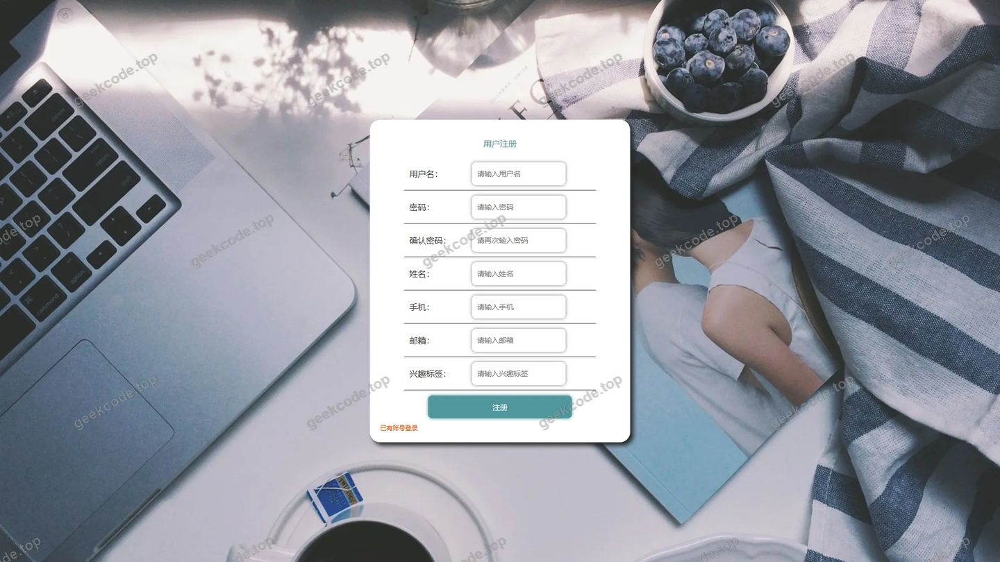</a>

<h4>前台-笔记分享列表</h4>

<h4>前台-公告信息列表</h4>

<a href="https://geekcode.top/archives/%E5%AD%A6%E7%94%9F%E8%AF%BB%E4%B9%A6%E7%AC%94%E8%AE%B0%E5%85%B1%E4%BA%AB?utm_source=github" title="查看完整源码">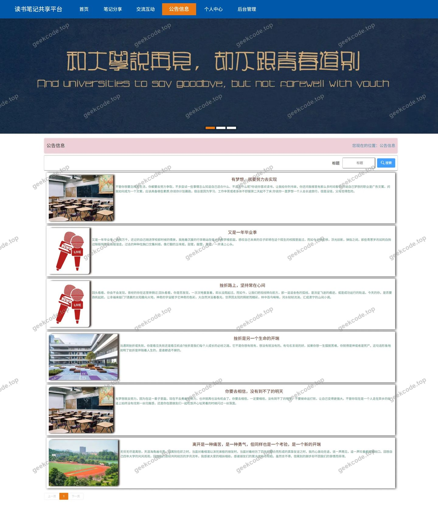</a>

<h4>前台-我的收藏列表</h4>

<a href="https://geekcode.top/archives/%E5%AD%A6%E7%94%9F%E8%AF%BB%E4%B9%A6%E7%AC%94%E8%AE%B0%E5%85%B1%E4%BA%AB?utm_source=github" title="查看完整源码">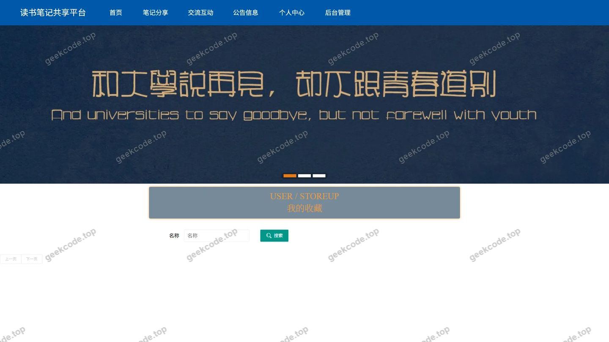</a>

<h4>前台-笔记分享评论列表</h4>

<a href="https://geekcode.top/archives/%E5%AD%A6%E7%94%9F%E8%AF%BB%E4%B9%A6%E7%AC%94%E8%AE%B0%E5%85%B1%E4%BA%AB?utm_source=github" title="查看完整源码">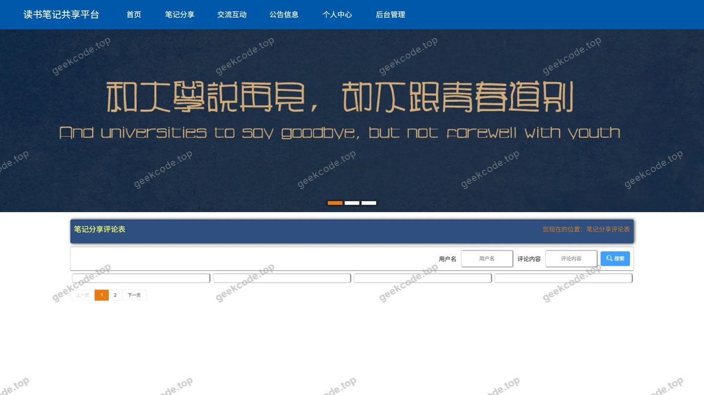</a>

<h4>前台-个人笔记列表</h4>

<h4>前台个人中心</h4>

<h4>前台-交流互动列表</h4>

<h4>前台-笔记分享-详情</h4>

<a href="https://geekcode.top/archives/%E5%AD%A6%E7%94%9F%E8%AF%BB%E4%B9%A6%E7%AC%94%E8%AE%B0%E5%85%B1%E4%BA%AB?utm_source=github" title="查看完整源码">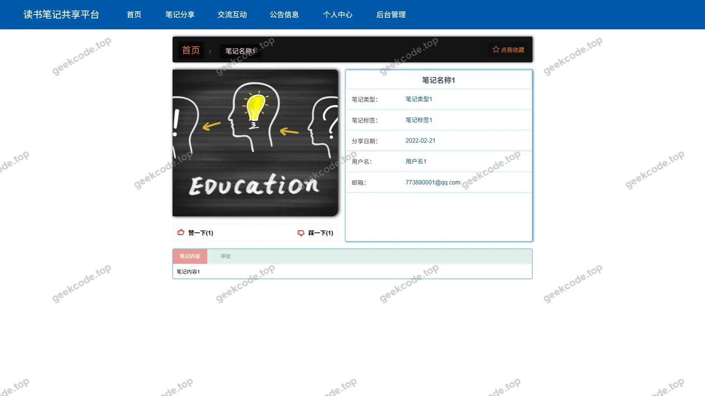</a>

<h4>前台-交流互动-详情</h4>

<h4>前台-公告信息-详情</h4>

<h4>前台-笔记分享评论-详情</h4>

<a href="https://geekcode.top/archives/%E5%AD%A6%E7%94%9F%E8%AF%BB%E4%B9%A6%E7%AC%94%E8%AE%B0%E5%85%B1%E4%BA%AB?utm_source=github" title="查看完整源码">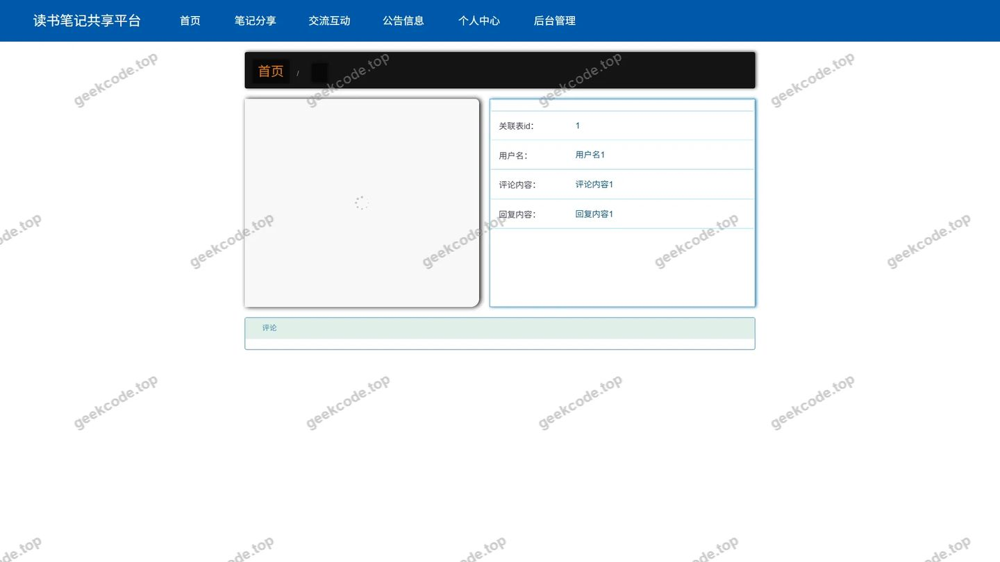</a>

<h4>前台-个人笔记-详情</h4>

<a href="https://geekcode.top/archives/%E5%AD%A6%E7%94%9F%E8%AF%BB%E4%B9%A6%E7%AC%94%E8%AE%B0%E5%85%B1%E4%BA%AB?utm_source=github" title="查看完整源码">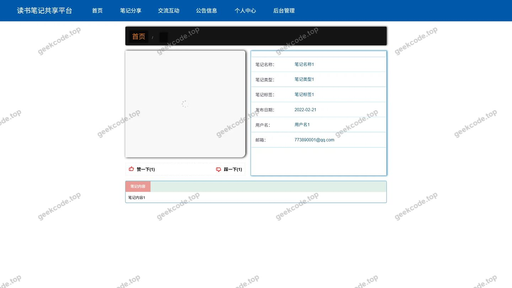</a>

<h3>后台管理端</h3>
<h4>后台-笔记分享</h4>

<a href="https://geekcode.top/archives/%E5%AD%A6%E7%94%9F%E8%AF%BB%E4%B9%A6%E7%AC%94%E8%AE%B0%E5%85%B1%E4%BA%AB?utm_source=github" title="查看完整源码">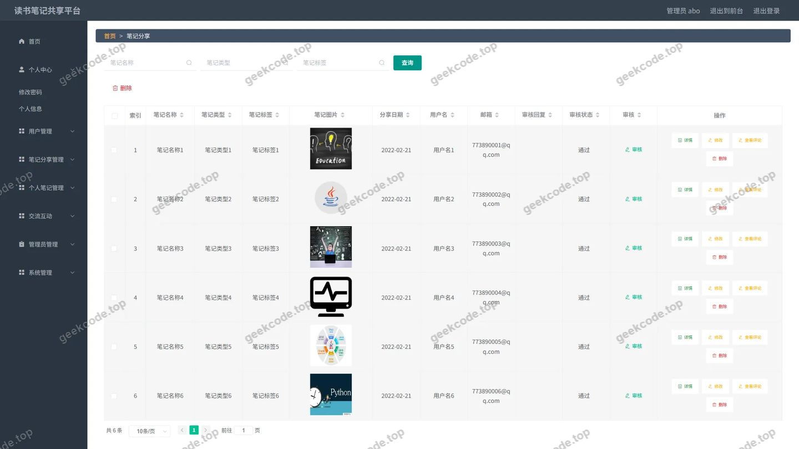</a>

<h4>后台-系统配置</h4>

<a href="https://geekcode.top/archives/%E5%AD%A6%E7%94%9F%E8%AF%BB%E4%B9%A6%E7%AC%94%E8%AE%B0%E5%85%B1%E4%BA%AB?utm_source=github" title="查看完整源码">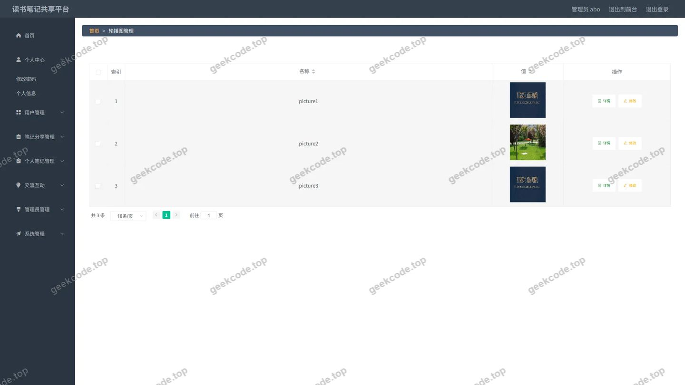</a>

<h4>后台-笔记分享评论</h4>

<a href="https://geekcode.top/archives/%E5%AD%A6%E7%94%9F%E8%AF%BB%E4%B9%A6%E7%AC%94%E8%AE%B0%E5%85%B1%E4%BA%AB?utm_source=github" title="查看完整源码">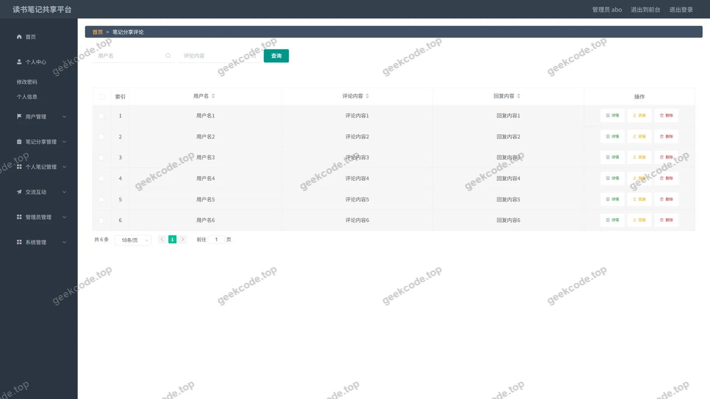</a>

<h4>后台-论坛</h4>

<a href="https://geekcode.top/archives/%E5%AD%A6%E7%94%9F%E8%AF%BB%E4%B9%A6%E7%AC%94%E8%AE%B0%E5%85%B1%E4%BA%AB?utm_source=github" title="查看完整源码">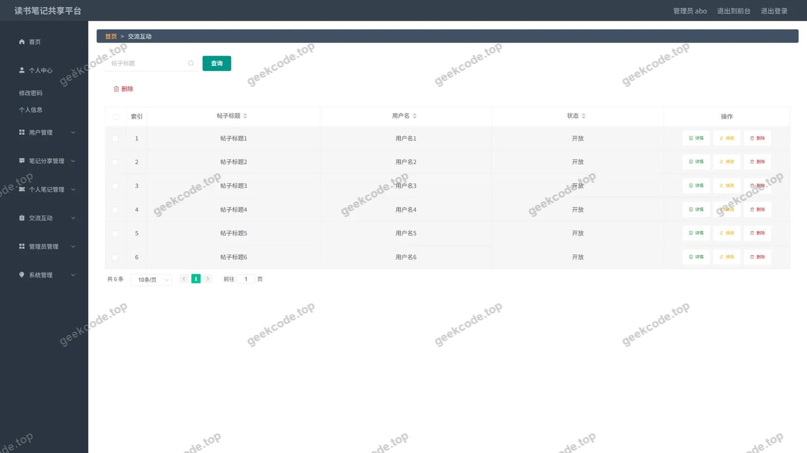</a>

<h4>后台-个人笔记</h4>

<a href="https://geekcode.top/archives/%E5%AD%A6%E7%94%9F%E8%AF%BB%E4%B9%A6%E7%AC%94%E8%AE%B0%E5%85%B1%E4%BA%AB?utm_source=github" title="查看完整源码">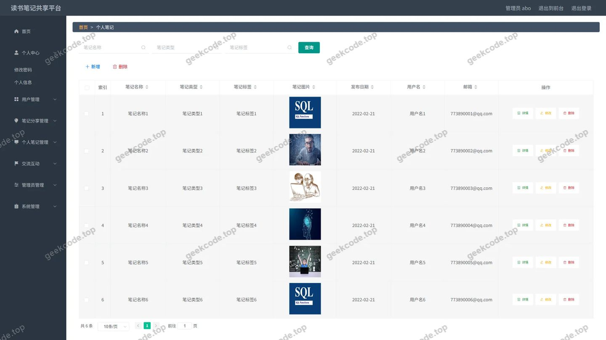</a>

<h4>后台首页</h4>

<a href="https://geekcode.top/archives/%E5%AD%A6%E7%94%9F%E8%AF%BB%E4%B9%A6%E7%AC%94%E8%AE%B0%E5%85%B1%E4%BA%AB?utm_source=github" title="查看完整源码">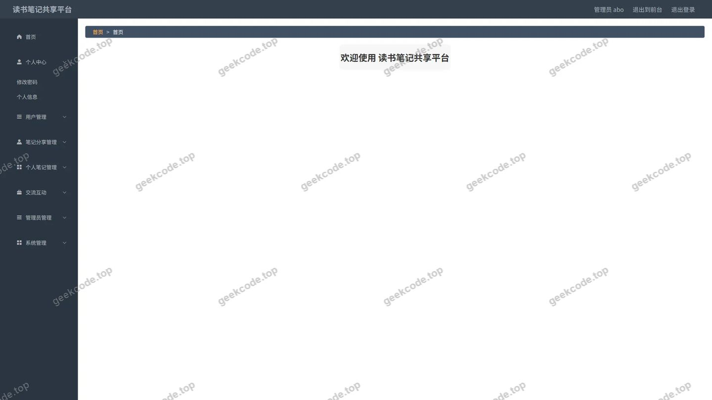</a>

<h4>后台-登录</h4>

<h4>后台-公告信息</h4>

<a href="https://geekcode.top/archives/%E5%AD%A6%E7%94%9F%E8%AF%BB%E4%B9%A6%E7%AC%94%E8%AE%B0%E5%85%B1%E4%BA%AB?utm_source=github" title="查看完整源码">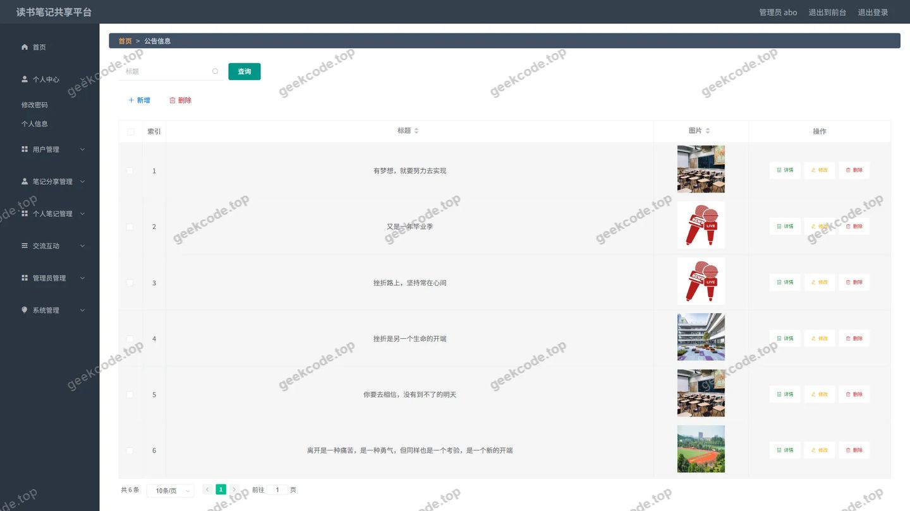</a>

<h4>后台-收藏</h4>

<a href="https://geekcode.top/archives/%E5%AD%A6%E7%94%9F%E8%AF%BB%E4%B9%A6%E7%AC%94%E8%AE%B0%E5%85%B1%E4%BA%AB?utm_source=github" title="查看完整源码">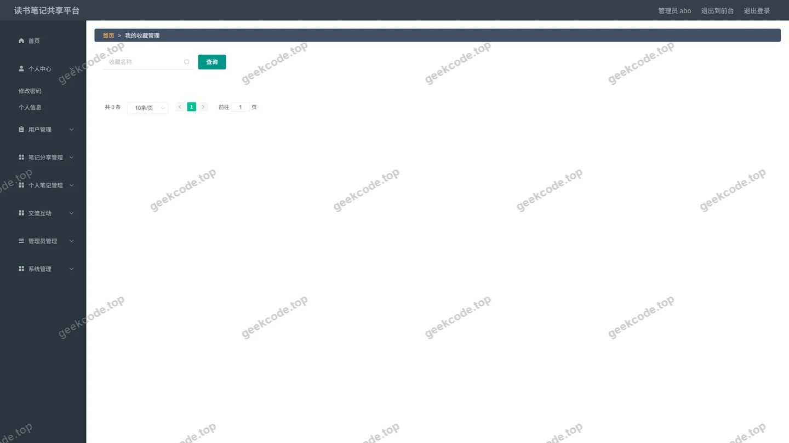</a>

---

## 获取完整源码

| 项目 | 说明 |
| --- | --- |
| 项目名 | 学生读书笔记共享 |
| 运行截图 | 本文 26 张（站点带水印原图，仓库 `images/` 目录） |
| 完整源码 | [https://geekcode.top/archives/%E5%AD%A6%E7%94%9F%E8%AF%BB%E4%B9%A6%E7%AC%94%E8%AE%B0%E5%85%B1%E4%BA%AB?utm_source=github](https://geekcode.top/archives/%E5%AD%A6%E7%94%9F%E8%AF%BB%E4%B9%A6%E7%AC%94%E8%AE%B0%E5%85%B1%E4%BA%AB?utm_source=github) |
| 咨询微信 | **ir9372**（备注：jingpin-yuanma） |
| 更多项目 | [极客代码 geekcode.top](https://geekcode.top/?utm_source=github) |

> 需要源码、部署、改配置、跑不起来等问题，加微信 ir9372 沟通，说明项目名即可。
